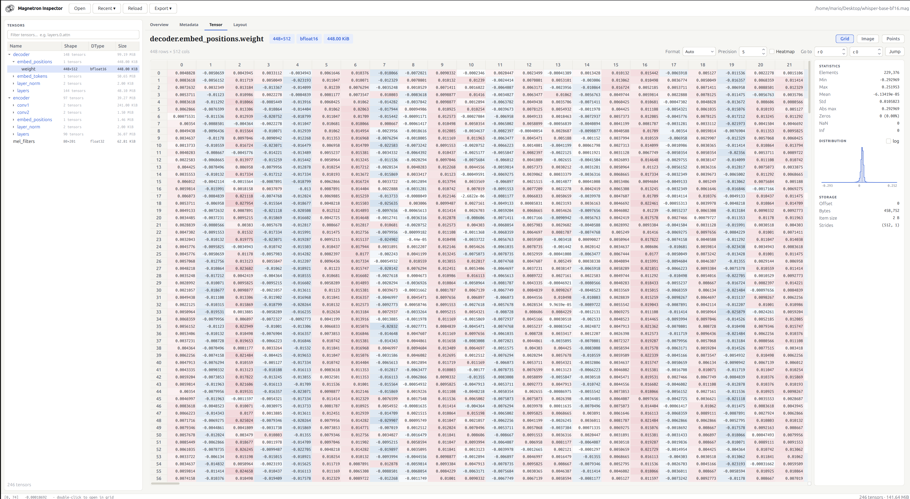
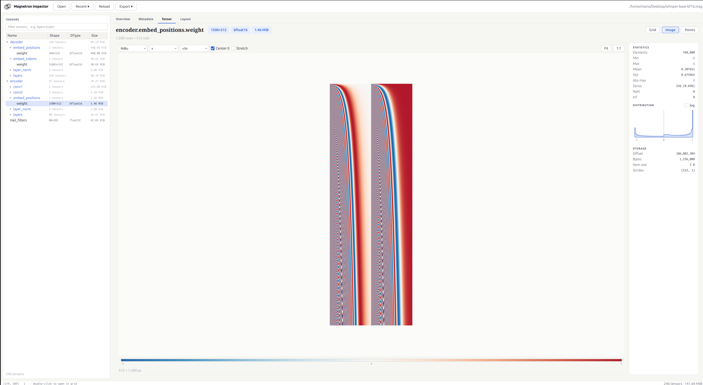
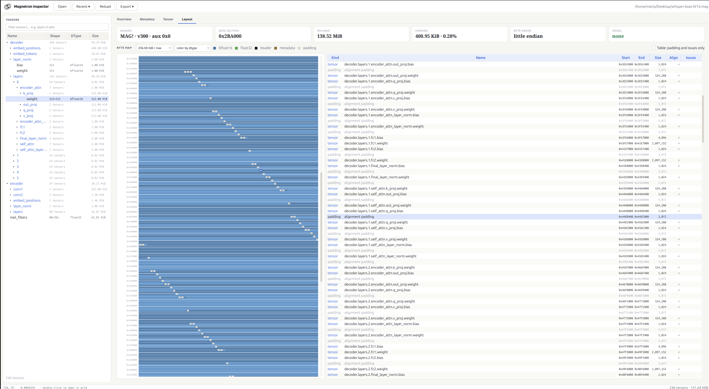
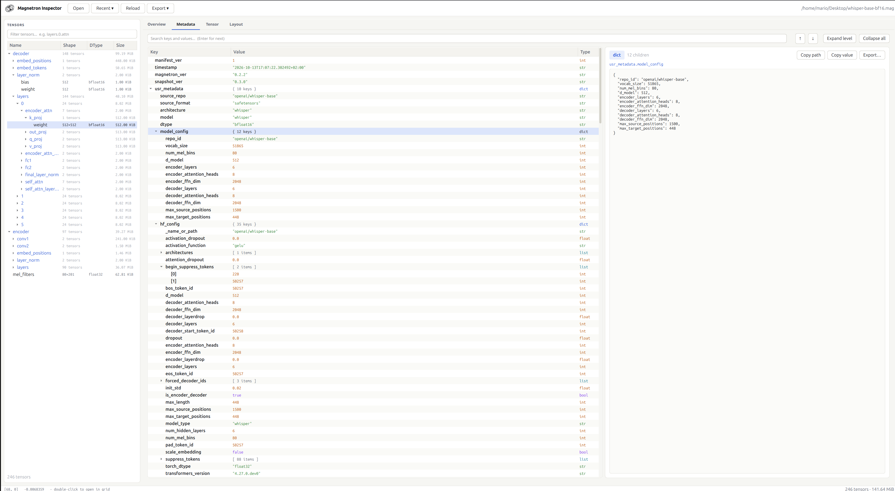

# magnetron-inspector

A PyQt6 desktop inspector for Magnetron `.mag` snapshot files.
Allows viewing the metadata tree, serialized tensors and their data.

```bash
uv run magnetron-inspector
```

On Linux, run this once so GNOME/KDE show the Magnetron logo in the taskbar and app launcher (it writes a `.desktop` entry and icon under `~/.local/share`):

```bash
uv run magnetron-inspector --install-desktop
```





